<div align="center">

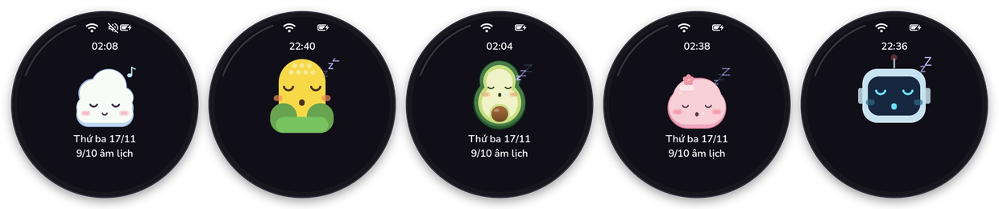

# Bắp

**A cute, fast voice assistant for the Seeed SenseCAP Watcher, talking straight to Google Gemini Live.**

No relay server. No cloud of our own. Five characters, voice apps, music, radio and Vietnamese
everyday tools, all running on one ESP32-S3.

[](https://github.com/vietanhdev/bap/actions/workflows/ci.yml)


[](LICENSE)

**English** · [Tiếng Việt](README.vi.md) · [Documentation](https://bap.nrl.ai)

</div>

---

## Contents

- [What it looks like](#what-it-looks-like)
- [Compared with the stock firmware](#compared-with-the-stock-firmware)
- [Features](#features)
- [Characters](#characters)
- [How it works](#how-it-works)
- [Performance](#performance)
- [Quick start](#quick-start)
- [Controls](#controls)
- [Settings page](#settings-page)
- [Privacy and security](#privacy-and-security)
- [Development](#development)
- [License](#license)

## What it looks like

All screenshots are taken from the device itself (`GET /screen.jpg`).

<table>
<tr>
<td align="center">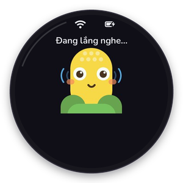<br><sub>Listening</sub></td>
<td align="center">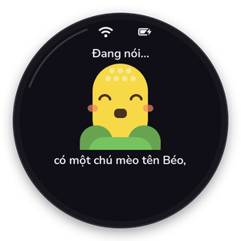<br><sub>Speaking, with live subtitles</sub></td>
<td align="center">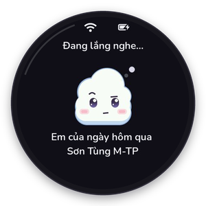<br><sub>Zing MP3 with synced lyrics</sub></td>
<td align="center">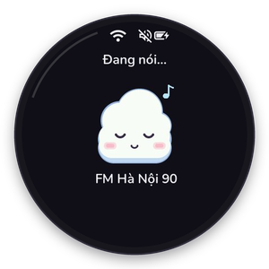<br><sub>Radio (VOV, FM Hà Nội)</sub></td>
</tr>
<tr>
<td align="center">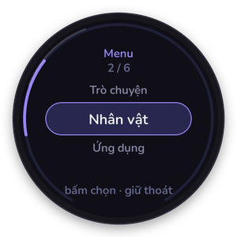<br><sub>Round menu (hold the wheel)</sub></td>
<td align="center">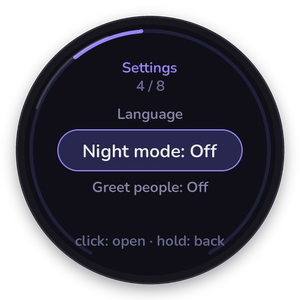<br><sub>Settings on the wheel</sub></td>
<td align="center">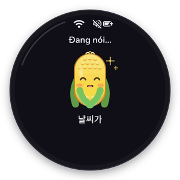<br><sub>Korean</sub></td>
<td align="center">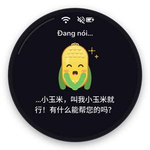<br><sub>Chinese</sub></td>
</tr>
</table>

## Compared with the stock firmware

|  | Stock SenseCraft / upstream xiaozhi | **Bắp** |
| --- | --- | --- |
| Voice backend | Vendor or self-hosted server relays audio | **Device ↔ Gemini Live directly** (WebSocket + TLS) |
| Wake → listening | depends on the relay server | **1.4–2.3 s** (was 2.9 s before tuning), TLS resumed in 0.1 s |
| Faces | GIF emoji | **5 characters drawn natively in LVGL**, 23 expressions, lip sync |
| Languages | chosen by the server | **Vietnamese, English, Korean, Chinese** (UI, prompt, subtitles, date) |
| Tools | Generic | **29 tools**: lunar calendar, weather, news, gold, FX, stocks, football, lottery, timers, notes, memory, music, radio |
| Touch screen | Not used | **Tap, double tap, swipe and hold gestures** (SPD2010 driver) |
| Camera AI | SenseCraft task flows | **On-device person detection**: wake-up greeting, morning briefing |
| Settings | Vendor app or server console | **Local web page** with password, health panel and 30-second OTA |
| Overnight | Same as daytime | **Night mode**: dimmed, volume capped at 35 %, optional do-not-disturb |

The factory partition (`nvsfactory`, device keys) is never written, and the stock firmware can be
restored at any time.

## Features

- **Natural conversation** through Gemini Live: real-time two-way audio, barge-in, live subtitles.
- **Five characters**, each with its own voice, personality and natively drawn face. Switch with the
  wheel, a swipe, or by voice ("call Bắp").
- **Voice apps**: morning news, bedtime stories, English practice, Korean basics, evening journal,
  fun horoscope, quiz, breathing, "what to eat today", 25-minute focus, look-and-tell (camera).
- **On-device tools** (no extra API keys): Vietnamese lunar calendar, weather and air quality
  (Open-Meteo), news (VnExpress), Vietcombank exchange rates, gold prices (PNJ and a local jeweller),
  VN-Index / VN30 / HNX / UPCoM, football fixtures and scores (Premier League, Champions League, La
  Liga, Serie A, Bundesliga, Ligue 1), lottery results, timers, alarms, notes, long-term memory,
  camera, volume and brightness.
- **Music and radio**: Zing MP3 search with synced lyrics, VOV and FM Hà Nội (HLS and MP3), and
  offline songs from the SD card with accent-insensitive search.
- **Four languages**: switch in the web page or the on-device menu. Korean and Chinese subtitles use a
  Noto Sans KR/SC subset stored in the assets partition. Adding a language is only data.
- **Presence**: the camera's Himax AI chip detects a person on the chip itself; the screen wakes and
  the character greets you. No image leaves the device and no Gemini quota is used.
- **Extensions**: declare webhooks (Home Assistant, n8n, your own server) in the web page and the
  assistant calls them through `extension.call`.
- **Settings page** at `http://bap-xxxx.local` (one name per device): API keys, model, language,
  city, characters, persona editing, conversation log, Wi-Fi, password, device health and OTA.

## Characters

| | Id | Name | What it is | Gemini voice | Personality |
| :-: | --- | --- | --- | --- | --- |
| 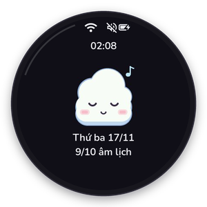 | `bong` | Bông | a little cotton cloud | Leda | Gentle, warm, encouraging (default) |
| 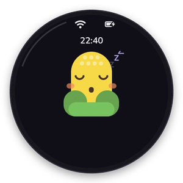 | `bap` | Bắp | a golden corn cob | Puck | Playful, energetic, crunchy jokes |
| 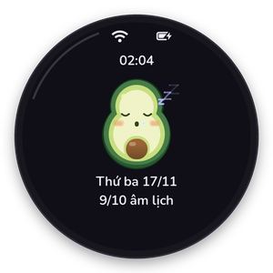 | `bo` | Bơ | a creamy avocado | Achird | Calm, relaxed, cares about your health |
| 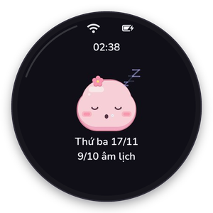 | `mochi` | Mochi | a pink mochi | Aoede | Sweet storyteller, great with kids |
| 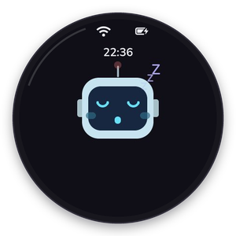 | `ti` | Tí | a tiny robot | Kore | Neat and tech-savvy |

Characters, apps, radio stations and languages are **data** in
[`firmware/data/assistant.json`](firmware/data/assistant.json); see
[docs/adding-a-character.md](docs/adding-a-character.md).

<p align="center"></p>

## How it works

<p align="center"></p>

Bắp is a thin layer on top of [xiaozhi-esp32](https://github.com/78/xiaozhi-esp32): a new
`Protocol` that speaks the Gemini Live API, plus `assistant::` modules for configuration, tools,
web UI, faces, menu and input. Upstream changes live in one small patch,
[`firmware/patches/xiaozhi-esp32.patch`](firmware/patches/xiaozhi-esp32.patch).

<p align="center"></p>

Details: [docs/architecture.md](docs/architecture.md) ·
[adding a tool](docs/adding-a-tool.md) · [adding a character](docs/adding-a-character.md).

## Performance

<p align="center"></p>

Main levers: TLS session tickets for every connection, ECP fixed-point optimisations, task stacks in
PSRAM, quantised face animations, fewer codecs, erase-ahead OTA writes and pausing the wake word and
camera inference during updates. `GET /api/perf` reports per-task CPU, stack headroom, heap,
uptime and Wi-Fi signal.

<p align="center"></p>

## Quick start

**You need:** a SenseCAP Watcher (W1-A/W1-B or the "for XiaoZhi" edition), a USB-C data cable, a
Linux machine with Docker and [uv](https://docs.astral.sh/uv/), and a Gemini API key from
[Google AI Studio](https://aistudio.google.com/apikey).

### 0. Back up the stock firmware (once)

```bash
mkdir -p backup
uv run --with esptool esptool --chip esp32s3 --port /dev/serial/by-id/usb-1a86_USB_Dual_Serial_*-if02 \
  --baud 921600 read-flash 0x0 0x2000000 backup/watcher-w1a-esp32s3-full-32MB.bin
( cd backup && sha256sum watcher-w1a-esp32s3-full-32MB.bin > watcher-w1a-esp32s3-full-32MB.bin.sha256 )
```

The dump contains the device's private keys. **Never commit or share `backup/`.**

### 1. Fetch upstream and apply the patch

```bash
firmware/scripts/apply_patch.sh   # clones xiaozhi-esp32 @ aaf1eb7 into vendor/ and applies the patch
```

### 2. Build

```bash
mkdir -p secrets && chmod 700 secrets
printf '%s' 'YOUR_GEMINI_API_KEY' > secrets/GEMINI_API_KEY && chmod 600 secrets/GEMINI_API_KEY

firmware/build.sh          # firmware (Docker espressif/idf:release-v6.1) → vendor/xiaozhi-esp32/build/xiaozhi.bin
firmware/build_assets.sh   # fonts, faces, wake word → firmware/build/assets.bin
```

Leave `secrets/GEMINI_API_KEY` empty to enter the key later in the web page (CI builds never contain
a key). Optional: `secrets/GEMINI_API_KEY_PAID`, a key from a billed project that is used only when
the free-tier key is rejected; the free key is retried after 1, 2, 4… up to 15 minutes.

Build variables: `GEMINI_MODEL`, `GEMINI_VOICE`, `WAKE_WORD` (default `wn9_hilili_tts`, "Hi Lili"),
`LANG_CODE`.

### 3. Flash

```bash
firmware/flash.sh               # first time: bootloader, partition table, otadata, app, assets
firmware/flash_app.sh           # later: app only
firmware/ota.sh bap-xxxx.local  # over Wi-Fi, no cable (about 30 s)
```

The scripts find the Watcher on USB by themselves; with several plugged in, choose one with
`PORT=/dev/serial/by-id/...`.

### 4. Wi-Fi and first conversation

1. On first boot the Watcher opens a hotspot named **`Bap-XXXX`**. Join it with your phone, pick your
   Wi-Fi and enter the password (or browse to `http://192.168.4.1`).
2. Open **`http://bap-xxxx.local`** (the address is also shown on screen).
3. Enter the Gemini API key if it was not built in, then pick a city, language and character.
4. Say **"Hi Lili"**, double-tap the screen or press the wheel, and start talking.

To change Wi-Fi later: hold the wheel → **Settings → Wi-Fi setup**, or use the button in the web page.

## Controls

<p align="center"></p>

| State | Wheel | Touch |
| --- | --- | --- |
| Resting | rotate: character · double press: apps | tap: giggle · double tap: talk · swipe: character |
| Talking | rotate: volume · press: pause / resume | tap: interrupt |
| Music | — | double tap: stop |
| Anywhere | hold 1 s: menu · hold 20 s: factory reset | hold: menu |
| Menu | rotate / press: move / open | swipe or tap top/bottom: move · tap centre: open |

## Settings page

<table>
<tr>
<td align="center">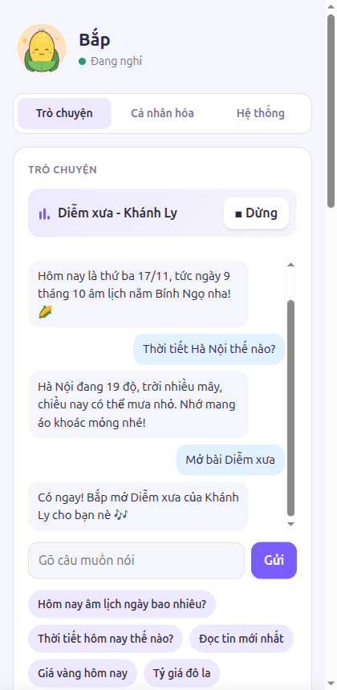<br><sub>Chat, now playing, quick asks</sub></td>
<td align="center">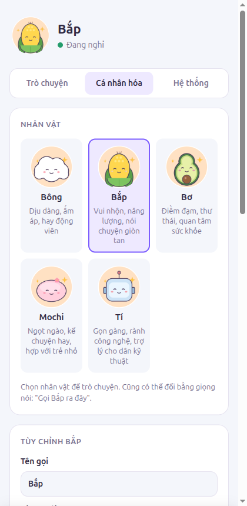<br><sub>Characters and personas</sub></td>
<td align="center">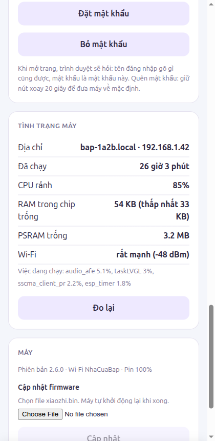<br><sub>Device health</sub></td>
<td align="center">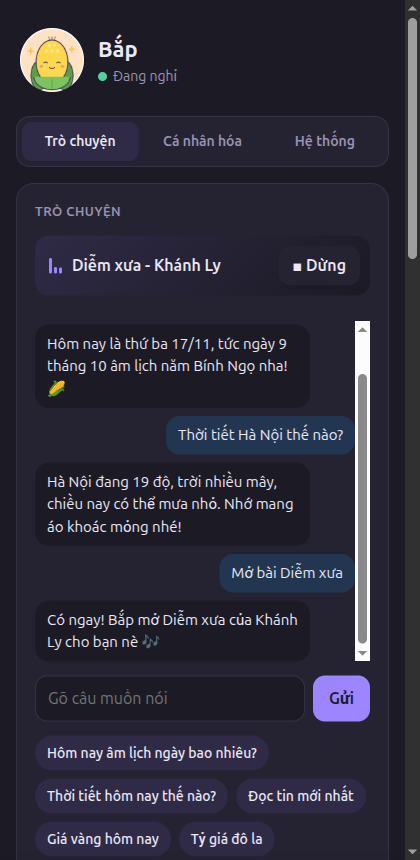<br><sub>Dark mode</sub></td>
</tr>
</table>

Screenshots use sample data.

## Privacy and security

- **The API key stays on the device** (NVS, or built in from `secrets/`). The browser only sees a
  masked key, and the device sends it only to Google over TLS. Anyone with physical access to the
  device or your built `xiaozhi.bin` can read it, so use a dedicated key with a quota and never
  share built binaries.
- **The settings page is LAN-only**, with an optional password (HTTP Basic, salted and iterated
  SHA-256). Every change (POST) requires an `X-Bap` header, which blocks cross-site form posts from
  the internet. Do not expose port 80 to the internet.
- **`nvsfactory` at `0x9000`** (Seeed's device keys) is never written: the flash scripts only touch
  `0x0`, `0x8000`, `0x10d000`, `0x200000` and `0xa00000`.
- Audio goes to Gemini only during a conversation (after the wake word, a tap or a press); the
  session closes after 30 s of silence. Camera images go to Gemini only when the assistant calls the
  photo tool. Person detection runs on the camera's own AI chip.
- Never commit `secrets/`, `backup/`, `server/.env`, `vendor/`, `firmware/build/` or build logs.
  See [CONTRIBUTING.md](CONTRIBUTING.md).

### Restore the stock firmware

```bash
firmware/restore_stock.sh   # checks the backup's SHA-256, then writes all 32 MB from 0x0
```

Without your own dump, reinstall the official SenseCraft firmware with Seeed's tool; your device keys
in `nvsfactory` are still there.

## Development

```bash
python3 firmware/scripts/validate_data.py      # assistant.json + every tool named in a prompt exists
for t in firmware/tests/test_*.cc; do g++ -std=c++17 -I firmware/src/assistant -o /tmp/t "$t" && /tmp/t; done
firmware/scripts/export_patch.sh               # after editing vendor/, refresh the patch
```

```
firmware/
  src/assistant/       Bắp modules: config, tools, web server, faces, menu, input, radio, Zing, SD
  src/protocols/       GeminiLiveProtocol and TicketSsl (TLS session resumption)
  data/assistant.json  characters, apps, radio stations, languages
  web/index.html       settings page served by the device
  patches/             the patch on top of upstream xiaozhi-esp32
  scripts/ tests/      patch tooling, data validation, host-side unit tests
docs/                  architecture, guides, images and diagrams
tools/                 desktop companion (Rust) and Gemini key helper
```

CI (`.github/workflows/ci.yml`) runs the unit tests, data validation, clang-format, a firmware build
with an empty API key and a gitleaks secret scan.

## License

- Bắp source code: [MIT](LICENSE).
- [xiaozhi-esp32](https://github.com/78/xiaozhi-esp32): MIT, © the upstream authors.
- `TicketSsl` is derived from [esp-ml307](https://github.com/78/esp-ml307) (Apache-2.0).
- Fonts: [Nunito](https://github.com/googlefonts/nunito) and
  [Noto Sans KR/SC](https://github.com/notofonts/noto-cjk), SIL Open Font License 1.1
  (`firmware/assets/fonts/`).
- The lunar calendar follows Hồ Ngọc Đức's published algorithm.
- Bắp is not affiliated with Seeed Studio or Google. "SenseCAP" and "Gemini" are trademarks of their
  owners.
