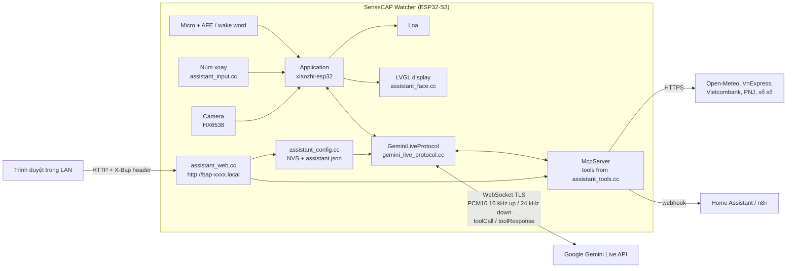

# Bắp

Trợ lý giọng nói tiếng Việt dễ thương cho **Seeed SenseCAP Watcher** (ESP32-S3, màn hình tròn
412x412, núm xoay, camera). Thiết bị nói chuyện **trực tiếp với Google Gemini Live API**, không
cần máy chủ trung gian. Firmware dựa trên [xiaozhi-esp32](https://github.com/78/xiaozhi-esp32) (MIT).

> **English summary.** Bắp is a cute Vietnamese voice-assistant firmware for the Seeed SenseCAP
> Watcher. It is built on upstream xiaozhi-esp32 and streams audio straight from the device to the
> Google Gemini Live API (no relay server). It ships five characters with their own voice,
> personality and natively drawn face, a set of voice "apps", and on-device tools (Vietnamese lunar
> calendar, weather, news, gold price, exchange rates, lottery, timers, alarms, notes, memory,
> camera). Characters and apps are plain data in `firmware/data/assistant.json`. Settings live in a
> LAN-only web UI at `http://bap-xxxx.local`. Code is MIT licensed.

## Tính năng

- **Nói chuyện tự nhiên bằng tiếng Việt** qua Gemini Live: âm thanh 2 chiều theo thời gian thực,
  ngắt lời được, hiện phụ đề trên màn hình.
- **5 nhân vật**, mỗi nhân vật có giọng, tính cách và gương mặt riêng (vẽ trực tiếp bằng LVGL, có
  23 biểu cảm, miệng nhép theo lời nói). Đổi nhân vật bằng núm xoay hoặc bằng lời ("gọi Bắp ra đây").
- **Ứng dụng bằng giọng nói**: bản tin sáng, kể chuyện cho bé, luyện nói tiếng Anh, học tiếng Hàn,
  nhật ký cuối ngày, tử vi vui, đố vui, hít thở
  thư giãn, hôm nay ăn gì, tập trung 25 phút, nhìn và kể. Nhấn đúp núm xoay để mở danh sách.
- **Công cụ chạy trên thiết bị** (không cần API key riêng):
  lịch âm và đổi âm sang dương, thời tiết (Open-Meteo), tin tức (VnExpress RSS), tỷ giá
  (Vietcombank), giá vàng (PNJ, tiệm Hải Hồng), chứng khoán (VN-Index, VN30, HNX, UPCoM), lịch và tỷ số bóng đá (Ngoại hạng Anh, C1, La
  Liga, Serie A, Bundesliga, Ligue 1), chất
  lượng không khí, kết quả xổ số, hẹn giờ,
  báo thức, ghi chú, ghi nhớ lâu dài, chụp ảnh bằng camera, chỉnh âm lượng và độ sáng.
- **Nhạc và radio**: tìm và phát bài trên Zing MP3 (kèm lời chạy theo nhạc), radio VOV và FM Hà
  Nội (HLS và MP3), nhạc trong thẻ nhớ SD (không cần mạng, tìm theo tên không dấu).
- **Nhiều ngôn ngữ**: tiếng Việt, tiếng Anh, tiếng Hàn, tiếng Trung (phụ đề Hàn/Trung dùng phông
  Noto Sans KR/SC trong phân vùng assets). Thêm ngôn ngữ chỉ là thêm dữ liệu vào `assistant.json`.
- **Màn hình cảm ứng và menu**: giữ núm xoay (hoặc giữ ngón tay trên màn hình) để mở menu tròn:
  trò chuyện, nhân vật, ứng dụng, radio, thiết lập, tắt máy.
- **Nhận biết có người**: chip AI trong camera (Himax) nhận ra người ngay trên máy, màn hình sáng
  lên và nhân vật mừng rỡ, không gửi ảnh đi đâu và không tốn lượt Gemini.
- **Tiện ích mở rộng**: khai báo webhook (Home Assistant, n8n, máy chủ riêng) trong giao diện web,
  trợ lý sẽ gọi chúng qua công cụ `mo_rong.goi`.
- **Tùy chọn**: tìm kiếm Google (cần key có bật thanh toán), chào khi camera thấy người, chế độ
  đêm (22:00 đến 06:00: màn hình dịu, loa tối đa 35%), không làm phiền ban đêm (tắt từ đánh
  thức), chào buổi sáng tự động khi thấy người, nhắc cắm sạc khi pin yếu.
- **Giao diện cài đặt trên thiết bị** tại `http://bap-xxxx.local` (4 ký tự cuối địa chỉ MAC, mỗi máy
  một tên): API key, model, ngôn ngữ, thành phố, nhân vật, sửa tên/giọng/tính cách, nhật ký hội
  thoại, Wi-Fi, mật khẩu trang cài đặt, tình trạng máy (CPU, RAM, sóng Wi-Fi), cập nhật firmware
  qua Wi-Fi (OTA, khoảng 35 giây).

## Nhân vật

| Mã | Tên | Là gì | Giọng Gemini | Tính cách |
| --- | --- | --- | --- | --- |
| `bong` | Bông | bé mây bông | Leda | Dịu dàng, ấm áp, hay động viên (mặc định) |
| `bap` | Bắp | trái bắp vàng | Puck | Vui nhộn, năng lượng, nói chuyện giòn tan |
| `bo` | Bơ | quả bơ sáp | Achird | Điềm đạm, thư thái, quan tâm sức khỏe |
| `mochi` | Mochi | viên bánh mochi hồng | Aoede | Ngọt ngào, kể chuyện hay, hợp với trẻ nhỏ |
| `ti` | Tí | chú robot tí hon | Kore | Gọn gàng, rành công nghệ |

Thêm nhân vật mới chỉ cần sửa dữ liệu, xem [docs/adding-a-character.md](docs/adding-a-character.md).

## Phần cứng

- **Seeed SenseCAP Watcher** (bản W1-A/W1-B hoặc bản "for XiaoZhi"): ESP32-S3, flash 32 MB, PSRAM
  8 MB, màn hình tròn 1,45" 412x412, núm xoay có nút nhấn, camera với chip AI Himax HX6538, micro
  và loa.
- Cáp USB-C dữ liệu (cổng nối tiếp USB kép CH342, xuất hiện dạng
  `/dev/serial/by-id/usb-1a86_USB_Dual_Serial_...-if02`).
- Máy tính Linux có Docker và [uv](https://docs.astral.sh/uv/) (để chạy `esptool`).
- Một Gemini API key từ [Google AI Studio](https://aistudio.google.com/apikey).

## Bắt đầu nhanh

### 0. Sao lưu firmware gốc (làm một lần, trước khi flash lần đầu)

```bash
mkdir -p backup
uv run --with esptool esptool --chip esp32s3 --port /dev/serial/by-id/usb-1a86_USB_Dual_Serial_*-if02 \
  --baud 921600 read-flash 0x0 0x2000000 backup/watcher-w1a-esp32s3-full-32MB.bin
( cd backup && sha256sum watcher-w1a-esp32s3-full-32MB.bin > watcher-w1a-esp32s3-full-32MB.bin.sha256 )
```

Bản dump này chứa khóa riêng của thiết bị. **Không bao giờ commit hay chia sẻ thư mục `backup/`.**

### 1. Lấy mã nguồn upstream và áp bản vá

```bash
firmware/scripts/apply_patch.sh     # clone xiaozhi-esp32 @ aaf1eb7 vào vendor/ và áp firmware/patches/xiaozhi-esp32.patch
```

### 2. Build

```bash
mkdir -p secrets && chmod 700 secrets
printf '%s' 'YOUR_GEMINI_API_KEY' > secrets/GEMINI_API_KEY && chmod 600 secrets/GEMINI_API_KEY

firmware/build.sh          # firmware (Docker espressif/idf:release-v6.1), ra vendor/xiaozhi-esp32/build/xiaozhi.bin
firmware/build_assets.sh   # font Nunito tiếng Việt + mặt nhân vật + wake word, ra firmware/build/assets.bin
```

Biến môi trường tùy chọn của `build.sh`: `GEMINI_MODEL` (mặc định `gemini-3.1-flash-live-preview`),
`GEMINI_VOICE`, `WAKE_WORD` (mặc định `wn9_hilili_tts`, tức "Hi Lili"), `LANG_CODE` (mặc định `vi-VN`).

Key cũng có thể để trống khi build và nhập sau trong giao diện web: tạo `secrets/GEMINI_API_KEY`
rỗng. Firmware do CI build luôn không có key.

**Key miễn phí + key trả phí dự phòng (tuỳ chọn).** `secrets/GEMINI_API_KEY` nên là key của một
project *không* bật thanh toán (free tier). Nếu có thêm `secrets/GEMINI_API_KEY_PAID` (key của một
project khác *đã* bật thanh toán), thiết bị luôn thử key miễn phí trước và chỉ dùng key trả phí khi
key miễn phí bị từ chối (hạn mức free của Live tính theo token mỗi phút). Sau lần bị từ chối, key miễn
phí được thử lại sau 1 phút, rồi 2, 4, 8 phút... tối đa 15 phút nếu vẫn bị từ chối. Cả hai key đều sửa
được trong giao diện web, và trang này cũng hiện số phiên đã dùng mỗi key từ lúc bật máy.

### 3. Flash

```bash
firmware/flash.sh          # lần đầu: bootloader, bảng phân vùng, otadata, ứng dụng, assets
firmware/flash_app.sh      # những lần sau: chỉ ứng dụng (nhanh)
firmware/flash_assets.sh   # chỉ phân vùng assets
firmware/ota.sh bap-xxxx.local  # cập nhật qua Wi-Fi, không cần cáp
```

Đổi cổng serial bằng `PORT=/dev/ttyACM0 firmware/flash.sh`.

### 4. Cài Wi-Fi và cấu hình

1. Lần đầu khởi động, thiết bị phát Wi-Fi tên **`Bap-XXXX`**. Kết nối điện thoại vào mạng đó, trang
   cấu hình sẽ tự mở (hoặc vào `http://192.168.4.1`), chọn Wi-Fi nhà bạn và nhập mật khẩu.
2. Khi thiết bị đã vào mạng, mở **`http://bap-xxxx.local`** (hoặc IP hiện trên màn hình) trên máy cùng mạng.
3. Nhập Gemini API key (nếu chưa build kèm), chọn thành phố và nhân vật.
4. Nói từ đánh thức "Hi Lili" hoặc nhấn núm xoay để bắt đầu.

### Điều khiển bằng núm xoay

| Trạng thái | Thao tác | Kết quả |
| --- | --- | --- |
| Đang nghỉ | Xoay | Đổi nhân vật |
| Đang nghỉ | Nhấn đúp | Mở danh sách ứng dụng, xoay để chọn, nhấn để mở |
| Đang trò chuyện | Xoay | Âm lượng |
| Đang trò chuyện | Nhấn | Dừng hoặc tiếp tục nghe |
| Bất kỳ | Giữ 1 giây | Mở menu (giữ lần nữa để quay lại) |
| Trong menu | Xoay / nhấn | Chọn / mở |
| Bất kỳ | Giữ 20 giây | Xóa toàn bộ cài đặt về mặc định |

### Điều khiển bằng cảm ứng

| Trạng thái | Thao tác | Kết quả |
| --- | --- | --- |
| Đang nghỉ | Chạm | Nhân vật cười khúc khích |
| Đang nghỉ | Chạm đúp | Bắt đầu trò chuyện |
| Đang nghỉ | Vuốt ngang | Đổi nhân vật |
| Đang nghỉ | Giữ | Mở menu |
| Đang nói | Chạm | Ngắt lời |
| Đang phát nhạc | Chạm đúp | Dừng nhạc |
| Trong menu | Vuốt hoặc chạm mục trên/dưới | Di chuyển; chạm mục giữa để mở; giữ để quay lại |

## Khôi phục firmware gốc

```bash
firmware/restore_stock.sh
```

Script kiểm tra SHA-256 của `backup/watcher-w1a-esp32s3-full-32MB.bin` rồi ghi lại toàn bộ 32 MB từ
địa chỉ `0x0`. Cần có bản sao lưu ở bước 0. Nếu không có bản dump riêng, có thể cài lại firmware
SenseCraft chính thức bằng công cụ của Seeed; phân vùng `nvsfactory` (0x9000) không bị Bắp ghi
đè nên khóa thiết bị vẫn còn.

## Kiến trúc



Chi tiết: [docs/architecture.md](docs/architecture.md). Thêm công cụ:
[docs/adding-a-tool.md](docs/adding-a-tool.md). Thêm nhân vật:
[docs/adding-a-character.md](docs/adding-a-character.md).

### Cấu trúc thư mục

```
firmware/
  src/assistant/     module C++ của Bắp: cấu hình, công cụ, web server, mặt nhân vật, núm xoay, lịch âm
  src/protocols/     GeminiLiveProtocol: kết nối trực tiếp tới Gemini Live
  data/assistant.json  nhân vật và ứng dụng (dữ liệu, không phải code)
  web/index.html     giao diện cài đặt do thiết bị phục vụ
  assets/            make_faces.py (ảnh GIF mặt nhân vật), fonts/ (Nunito tiếng Việt)
  patches/           bản vá cho upstream xiaozhi-esp32
  scripts/           apply_patch.sh, export_patch.sh, validate_data.py
  tests/             kiểm thử chạy trên máy tính (g++)
  build.sh, build_assets.sh, flash*.sh, ota.sh, restore_stock.sh
docs/                tài liệu kỹ thuật
research/            ghi chú nghiên cứu
server/              thử nghiệm máy chủ xiaozhi tự host (không bắt buộc)
vendor/xiaozhi-esp32 upstream (không commit, tạo lại bằng apply_patch.sh)
```

## An toàn và quyền riêng tư

- **API key nằm trên thiết bị.** Key được lưu trong NVS (namespace `assistant`) hoặc nhúng lúc build
  từ `secrets/GEMINI_API_KEY`. Trình duyệt chỉ thấy key đã che (`AIza••••••••xxxx`). Thiết bị gửi
  key trực tiếp tới Google qua TLS, không qua máy chủ nào khác. Vì key nằm trong firmware, ai có
  quyền truy cập vật lý vào thiết bị hoặc file `xiaozhi.bin` bạn tự build đều có thể đọc được key:
  hãy dùng key riêng cho thiết bị, giới hạn quota, và không chia sẻ file `.bin` đã build.
- **Giao diện web chỉ dùng trong mạng LAN**, có thể đặt mật khẩu (HTTP Basic, chỉ lưu dạng băm
  SHA-256 có salt). Mọi yêu cầu thay đổi (POST) phải
  có header `X-Bap`. Trình duyệt không tự gửi header tùy chỉnh khi một trang web lạ gửi form sang
  thiết bị, nên điều này chặn tấn công CSRF từ Internet. Đừng mở cổng 80 của thiết bị ra Internet
  và chỉ dùng trong mạng Wi-Fi tin cậy.
- **Phân vùng `nvsfactory` ở `0x9000`** (EUI, khóa thiết bị của Seeed) không bao giờ bị ghi:
  `flash.sh` chỉ ghi `0x0`, `0x8000`, `0x10d000`, `0x200000` và `0xa00000`.
- Âm thanh chỉ được gửi lên Gemini khi đang trong phiên trò chuyện (sau từ đánh thức hoặc nhấn
  núm). Phiên tự đóng sau thời gian chờ (mặc định 30 giây). Ảnh camera chỉ được gửi lên Gemini khi
  trợ lý gọi công cụ chụp ảnh (`self.camera.take_photo`). Tính năng chào người dùng bộ phát hiện
  người chạy ngay trên chip AI của camera.
- Không bao giờ commit: `secrets/`, `backup/`, `server/.env`, `server/data/.config.yaml`, `vendor/`,
  `firmware/build/`, file log build. Xem [CONTRIBUTING.md](CONTRIBUTING.md).

## Phát triển

```bash
python3 firmware/scripts/validate_data.py                 # kiểm tra assistant.json
g++ -std=c++17 -I firmware/src/assistant -o /tmp/t firmware/tests/test_lunar.cc && /tmp/t
firmware/scripts/export_patch.sh                          # sau khi sửa vendor/, cập nhật bản vá
```

CI (`.github/workflows/ci.yml`) chạy kiểm thử, kiểm tra dữ liệu, clang-format, build firmware với
API key rỗng, và quét bí mật bằng gitleaks.

## Giấy phép

- Mã nguồn của Bắp: [MIT](LICENSE), bản quyền vietanhdev.
- [xiaozhi-esp32](https://github.com/78/xiaozhi-esp32): MIT, bản quyền các tác giả upstream.
- Font [Nunito](https://github.com/googlefonts/nunito): SIL Open Font License 1.1, xem
  `firmware/assets/fonts/Nunito-OFL.txt`.
- Font [Noto Sans KR/SC](https://github.com/notofonts/noto-cjk) (tập con, phụ đề Hàn/Trung): SIL
  Open Font License 1.1, xem `firmware/assets/fonts/NotoSansCJK-OFL.txt`.
- Thuật toán lịch âm theo công bố của Hồ Ngọc Đức.
- Bắp không liên kết với Seeed Studio hay Google. "SenseCAP" và "Gemini" là nhãn hiệu của chủ sở
  hữu tương ứng.
