<div align="center">

<a href="https://bap.nrl.ai/vi">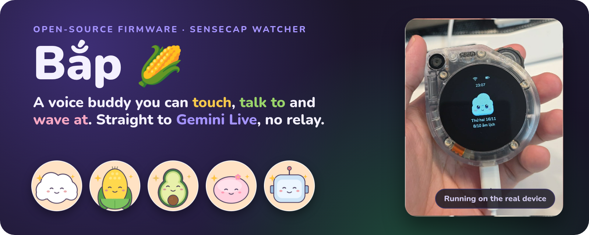</a>

<h3>Firmware trợ lý giọng nói dễ thương, nhanh nhạy cho Seeed SenseCAP Watcher</h3>

Thiết bị nói chuyện thẳng với Google Gemini Live. Không máy chủ trung gian, không đám mây riêng.

[](https://github.com/vietanhdev/bap/actions/workflows/ci.yml)


[](LICENSE)

[English](README.md) · **Tiếng Việt**

[**Tài liệu**](https://bap.nrl.ai/vi) ·
[Demo](#-xem-thực-tế) ·
[Tính năng](#-tính-năng) ·
[Bắt đầu nhanh](#-bắt-đầu-nhanh) ·
[Cách hoạt động](#-cách-hoạt-động) ·
[Điều khiển](#-điều-khiển)

</div>

## 🎬 Xem thực tế

Quay trực tiếp từ màn hình của máy (`GET /screen.jpg`), đúng tốc độ thật.

<table>
<tr>
<td align="center" width="33%"><br><b>Hỏi gì cũng được</b><br><sub>Trả lời bằng giọng nói, có phụ đề, rồi mở bài hát</sub></td>
<td align="center" width="33%">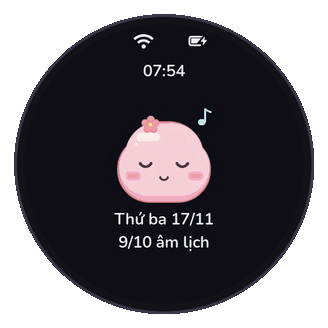<br><b>Năm nhân vật</b><br><sub>Chọn trong Thiết lập</sub></td>
<td align="center" width="33%"><br><b>Menu tròn</b><br><sub>Giữ núm xoay hoặc giữ màn hình</sub></td>
</tr>
</table>

<p align="center">
<br>
<sub>Mỗi nhân vật 23 biểu cảm, vẽ trực tiếp bằng LVGL, nhép miệng khi nói</sub>
</p>

<details>
<summary><b>Thêm ảnh màn hình</b>: nhạc, radio, menu, tiếng Hàn và tiếng Trung</summary>
<br>
<table>
<tr>
<td align="center"><br><sub>Đang lắng nghe</sub></td>
<td align="center">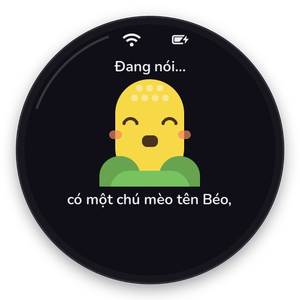<br><sub>Đang nói, có phụ đề</sub></td>
<td align="center">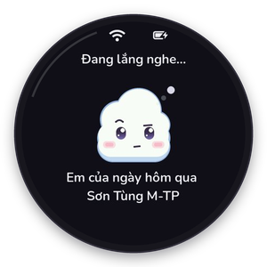<br><sub>Zing MP3, lời chạy theo nhạc</sub></td>
<td align="center"><br><sub>Radio (VOV, FM Hà Nội)</sub></td>
</tr>
<tr>
<td align="center"><br><sub>Menu tròn</sub></td>
<td align="center">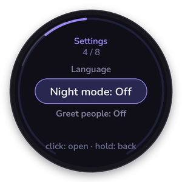<br><sub>Thiết lập bằng núm xoay</sub></td>
<td align="center">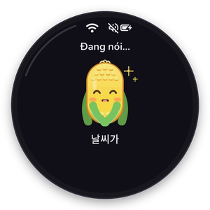<br><sub>Tiếng Hàn</sub></td>
<td align="center">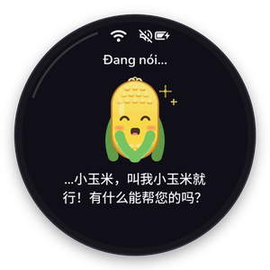<br><sub>Tiếng Trung</sub></td>
</tr>
</table>
</details>

## ✨ Tính năng

<table>
<tr>
<td width="50%" valign="top">

### 🗣️ Nói chuyện tự nhiên
Âm thanh hai chiều thời gian thực với Gemini Live: ngắt lời lúc nào cũng được, phụ đề hiện trên
màn hình tròn. Chạm đúp màn hình hoặc nhấn núm xoay (hoặc nói **"Hi Lili"** sau khi bật gọi bằng giọng nói trong cài đặt).

</td>
<td width="50%" valign="top">

### 👆 Sinh ra để được chạm vào
Chạm là cười khúc khích, chạm đúp để nói chuyện, giữ để mở menu. Núm xoay dùng để trò chuyện,
chỉnh âm lượng, và nhấn nhanh 3 lần để tắt máy.

</td>
</tr>
<tr>
<td valign="top">

### 👀 Nhận ra bạn
Chip AI ngay trong camera nhận ra có người, màn hình sáng lên và nhân vật chào bạn, mỗi sáng còn
đọc bản tin ngắn. Không gửi ảnh đi đâu, không tốn lượt Gemini.

</td>
<td valign="top">

### 🎭 Năm nhân vật
Bông, Bắp, Bơ, Mochi và Tí, mỗi nhân vật có giọng, tính cách và gương mặt riêng. Nhân vật, ứng
dụng và ngôn ngữ đều là dữ liệu, thêm mới không cần viết C++.

</td>
</tr>
<tr>
<td valign="top">

### 🛠️ 28 công cụ trên máy
Lịch âm, thời tiết và chất lượng không khí, tin tức, giá vàng, tỷ giá, chứng khoán, bóng đá, xổ
số, hẹn giờ, báo thức, ghi chú, ghi nhớ lâu dài. Không cần thêm API key.

</td>
<td valign="top">

### 🎵 Nhạc và radio
Zing MP3 kèm lời chạy theo nhạc, VOV và FM Hà Nội, nhạc trong thẻ SD không cần mạng, tìm theo tên
không dấu.

</td>
</tr>
<tr>
<td valign="top">

### 🌏 Bốn ngôn ngữ
Việt, Anh, Hàn, Trung: cả hội thoại, chữ trên màn hình, menu lẫn dòng ngày tháng (phụ đề Hàn và
Trung dùng phông Noto Sans).

</td>
<td valign="top">

### 🌙 Êm ái về đêm
Chế độ đêm làm dịu màn hình và giới hạn âm lượng, không làm phiền thì tắt nghe từ đánh thức, vắng
người thì màn hình dịu dần rồi tắt hẳn.

</td>
</tr>
</table>

<details>
<summary><b>Còn nữa</b>: ứng dụng bằng giọng nói, tiện ích mở rộng, trang cài đặt</summary>

- **Ứng dụng bằng giọng nói**: bản tin sáng, kể chuyện cho bé, luyện nói tiếng Anh, học tiếng Hàn,
  nhật ký cuối ngày, tử vi vui, đố vui, hít thở thư giãn, hôm nay ăn gì, tập trung 25 phút, nhìn và
  kể (camera).
- **Tiện ích mở rộng**: khai báo webhook (Home Assistant, n8n, máy chủ riêng) trong trang cài đặt,
  trợ lý sẽ gọi qua công cụ `extension.call`.
- **Trang cài đặt** tại `http://bap-xxxx.local` (mỗi máy một tên): API key, model, ngôn ngữ, thành
  phố, nhân vật, sửa tính cách, nhật ký hội thoại, Wi-Fi, mật khẩu, tình trạng máy và cập nhật
  firmware qua Wi-Fi trong 30 giây.
- **Nguồn dữ liệu**: Open-Meteo, VnExpress, Vietcombank, PNJ và tiệm vàng Hải Hồng, CafeF, ESPN,
  Zing MP3, VOV. Tất cả đều được gọi thẳng từ máy.

</details>

### So với firmware gốc

|  | SenseCraft gốc / xiaozhi upstream | **Bắp** |
| --- | --- | --- |
| Xử lý giọng nói | Âm thanh đi qua máy chủ của hãng hoặc tự dựng | **Thiết bị ↔ Gemini Live trực tiếp** (WebSocket + TLS) |
| Gọi → bắt đầu nghe | Tùy máy chủ trung gian | **1,4–2,3 giây**, TLS nối lại trong 0,1 giây |
| Gương mặt | Emoji GIF | **5 nhân vật vẽ bằng LVGL**, 23 biểu cảm, nhép miệng |
| Ngôn ngữ | Do máy chủ quyết định | **Việt, Anh, Hàn, Trung** |
| Màn hình cảm ứng | Chưa dùng | **Chạm, chạm đúp, kéo, giữ** |
| AI camera | Luồng tác vụ SenseCraft | **Nhận biết người ngay trên chip** để chào |
| Cài đặt | Ứng dụng hoặc trang quản trị của hãng | **Trang web trong mạng nhà**, mật khẩu, tình trạng máy, OTA |
| Ban đêm | Như ban ngày | **Chế độ đêm**, không làm phiền, nghỉ màn hình |

Phân vùng `nvsfactory` (khóa thiết bị) không bao giờ bị ghi, có thể khôi phục firmware gốc bất cứ
lúc nào.

## 🎭 Nhân vật

| | Tên | Là gì | Giọng | Tính cách |
| :-: | --- | --- | --- | --- |
| 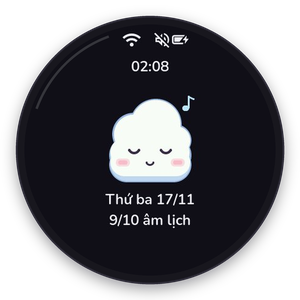 | **Bông** `bong` | bé mây bông | Leda | Dịu dàng, ấm áp, hay động viên (mặc định) |
| 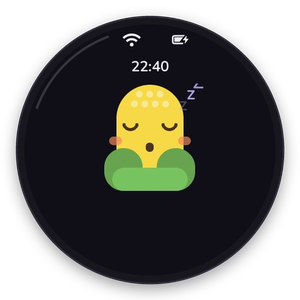 | **Bắp** `bap` | trái bắp vàng | Puck | Vui nhộn, năng lượng, nói chuyện giòn tan |
| 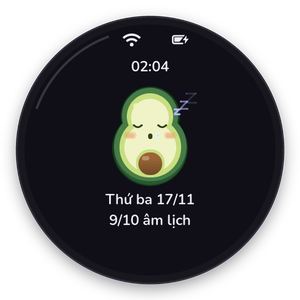 | **Bơ** `bo` | quả bơ sáp | Achird | Điềm đạm, thư thái, quan tâm sức khỏe |
| 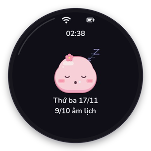 | **Mochi** `mochi` | viên bánh mochi hồng | Aoede | Ngọt ngào, kể chuyện hay, hợp với trẻ nhỏ |
| 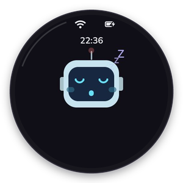 | **Tí** `ti` | chú robot tí hon | Kore | Gọn gàng, rành công nghệ |

Tên, giọng và tính cách sửa được trong trang cài đặt. Muốn thêm nhân vật riêng, xem
[docs/adding-a-character.md](docs/adding-a-character.md).

## 🚀 Bắt đầu nhanh

<table>
<tr>
<td width="42%">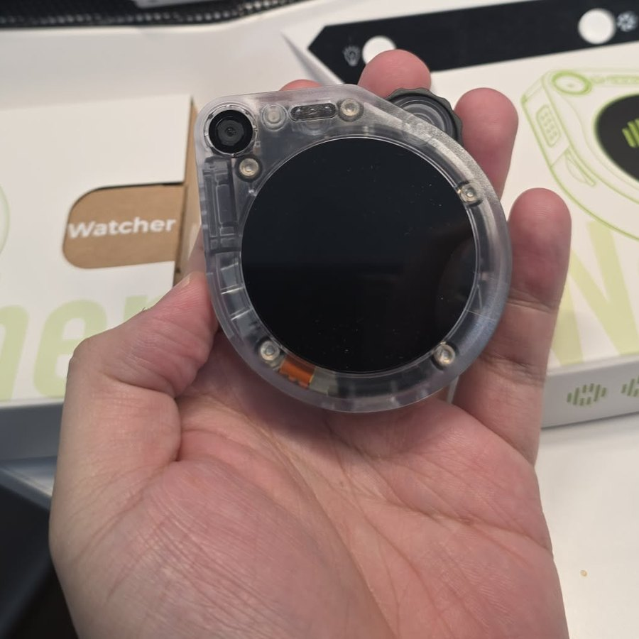</td>
<td valign="top">

**Cần có**

- **Seeed SenseCAP Watcher** (W1-A, W1-B hoặc bản "for XiaoZhi"): ESP32-S3, flash 32 MB, PSRAM
  8 MB, màn hình tròn cảm ứng 412×412, núm xoay, camera có chip AI Himax, micro và loa
- cáp USB-C có truyền dữ liệu
- máy Linux có Docker và [uv](https://docs.astral.sh/uv/)
- Gemini API key từ [Google AI Studio](https://aistudio.google.com/apikey)

</td>
</tr>
</table>

**1. Sao lưu firmware gốc** (làm một lần). Bản sao lưu chứa khóa riêng của máy: không bao giờ commit
hay chia sẻ thư mục `backup/`.

```bash
mkdir -p backup
uv run --with esptool esptool --chip esp32s3 --port /dev/serial/by-id/usb-1a86_USB_Dual_Serial_*-if02 \
  --baud 921600 read-flash 0x0 0x2000000 backup/watcher-w1a-esp32s3-full-32MB.bin
( cd backup && sha256sum watcher-w1a-esp32s3-full-32MB.bin > watcher-w1a-esp32s3-full-32MB.bin.sha256 )
```

**2. Lấy mã upstream, build và nạp**

```bash
firmware/scripts/apply_patch.sh     # clone xiaozhi-esp32 @ aaf1eb7 vào vendor/ rồi áp bản vá

mkdir -p secrets && chmod 700 secrets
printf '%s' 'YOUR_GEMINI_API_KEY' > secrets/GEMINI_API_KEY && chmod 600 secrets/GEMINI_API_KEY

firmware/build.sh                   # firmware, build trong Docker (espressif/idf:release-v6.1)
firmware/build_assets.sh            # phông chữ, gương mặt, từ đánh thức
firmware/flash.sh                   # nạp lần đầu qua USB
```

**3. Kết nối và trò chuyện**

1. Lần đầu khởi động, Watcher phát Wi-Fi tên **`Bap-XXXX`**. Kết nối điện thoại vào rồi chọn Wi-Fi
   nhà bạn (hoặc mở `http://192.168.4.1`).
2. Mở **`http://bap-xxxx.local`** (địa chỉ cũng hiện trên màn hình), chọn thành phố, ngôn ngữ và
   nhân vật.
3. Chạm đúp màn hình hoặc nhấn núm xoay rồi nói. Gọi bằng giọng nói ("Hi Lili") mặc định tắt cho đỡ
   tốn điện; bật trong trang cài đặt hoặc menu núm xoay.

Những lần sau cập nhật qua Wi-Fi trong khoảng 30 giây: `firmware/ota.sh bap-xxxx.local`.
Đổi Wi-Fi: giữ núm xoay → **Thiết lập → Cài Wi-Fi**.

<details>
<summary><b>Tùy chọn build</b>: API key, model, từ đánh thức, script nạp</summary>

- Để trống `secrets/GEMINI_API_KEY` nếu muốn nhập key sau trong trang cài đặt (firmware do CI build
  không bao giờ có key).
- Tùy chọn `secrets/GEMINI_API_KEY_PAID`: key của project đã bật thanh toán, chỉ dùng khi key miễn
  phí bị từ chối. Key miễn phí được thử lại sau 1, 2, 4… tối đa 15 phút.
- Biến khi build: `GEMINI_MODEL`, `GEMINI_VOICE`, `WAKE_WORD` (mặc định `wn9_hilili_tts`, tức "Hi
  Lili"), `LANG_CODE`.
- `firmware/flash_app.sh` chỉ ghi ứng dụng, `firmware/flash_assets.sh` chỉ ghi phân vùng assets. Các
  script tự tìm Watcher trên USB; nếu cắm nhiều máy, chọn bằng `PORT=/dev/serial/by-id/...`.
- Khôi phục firmware gốc bằng `firmware/restore_stock.sh` (kiểm tra SHA-256 của bản sao lưu rồi ghi
  lại toàn bộ 32 MB). Không có bản sao lưu thì cài lại SenseCraft bằng công cụ của Seeed: khóa thiết
  bị trong `nvsfactory` vẫn còn nguyên.

</details>

## 🧠 Cách hoạt động

<p align="center"></p>

Bắp là một lớp mỏng trên [xiaozhi-esp32](https://github.com/78/xiaozhi-esp32): một `Protocol` mới
nói chuyện với Gemini Live API, cùng các module `assistant::` cho cấu hình, công cụ, trang web,
gương mặt, menu và điều khiển. Thay đổi với upstream gói gọn trong một bản vá nhỏ,
[`firmware/patches/xiaozhi-esp32.patch`](firmware/patches/xiaozhi-esp32.patch).

<details>
<summary><b>Một lượt trò chuyện, từng bước</b></summary>
<br>
<p align="center"></p>
</details>

<details>
<summary><b>Nhân vật, ứng dụng và ngôn ngữ là dữ liệu</b></summary>
<br>
<p align="center"></p>
</details>

Xem thêm: [kiến trúc](docs/architecture.md) · [thêm công cụ](docs/adding-a-tool.md) ·
[thêm nhân vật](docs/adding-a-character.md).

### ⚡ Hiệu năng

<p align="center"></p>

Các thay đổi chính: dùng lại phiên TLS cho mọi kết nối, ECC dạng fixed-point, stack của tác vụ đặt
trong PSRAM, giảm khung hình hoạt ảnh, bỏ bớt codec, và khi OTA thì xóa flash trước khi ghi, tạm
dừng từ đánh thức và camera. `GET /api/perf` cho biết CPU từng tác vụ, stack còn trống, heap, thời
gian chạy và sóng Wi-Fi.

<details>
<summary><b>Bố cục flash và ngân sách RAM</b></summary>
<br>
<p align="center"></p>
</details>

## 🎛️ Điều khiển

<p align="center"></p>

| Trạng thái | Núm xoay | Cảm ứng |
| --- | --- | --- |
| Đang nghỉ | xoay: âm lượng · nhấn đúp: ứng dụng · nhấn 3 lần: tắt máy | chạm: cười khúc khích · chạm đúp: trò chuyện |
| Đang trò chuyện | xoay: âm lượng · nhấn: dừng / tiếp tục | chạm: ngắt lời · chạm đúp: kết thúc |
| Đang phát nhạc | — | chạm đúp: dừng nhạc |
| Bất kỳ | giữ 1 giây: menu · giữ 20 giây: xóa cài đặt | giữ: menu |
| Trong menu | xoay / nhấn: di chuyển / mở | kéo hoặc chạm trên / dưới: di chuyển · chạm giữa: mở |

## ⚙️ Trang cài đặt

<table>
<tr>
<td align="center">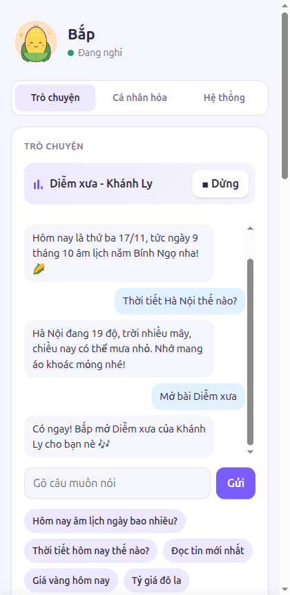<br><sub>Trò chuyện, đang phát, hỏi nhanh</sub></td>
<td align="center">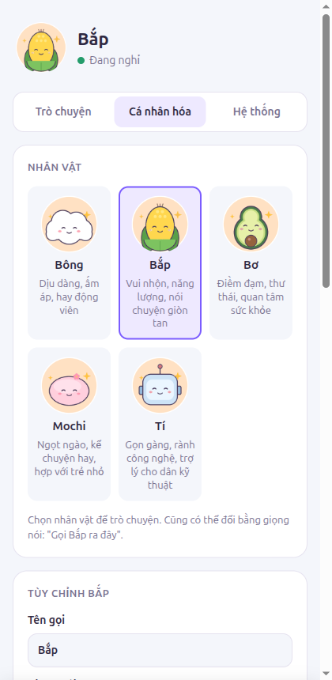<br><sub>Nhân vật và tính cách</sub></td>
<td align="center">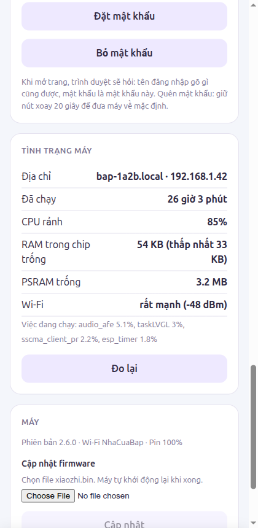<br><sub>Tình trạng máy</sub></td>
<td align="center">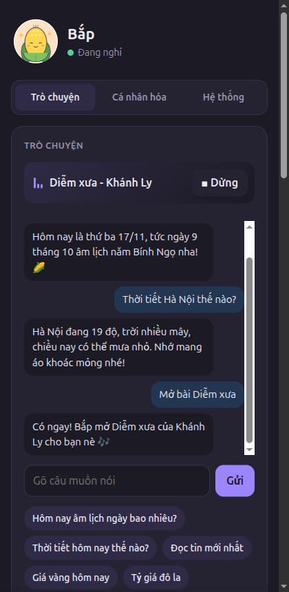<br><sub>Giao diện tối</sub></td>
</tr>
</table>

<sub>Ảnh chụp dùng dữ liệu mẫu.</sub>

## 🔒 An toàn và quyền riêng tư

- **API key nằm trên thiết bị** (NVS, hoặc nhúng lúc build từ `secrets/`). Trình duyệt chỉ thấy key
  đã che, và máy chỉ gửi key tới Google qua TLS. Ai có máy hoặc file `bap.bin` bạn tự build đều
  đọc được key, vì vậy hãy dùng key riêng có giới hạn quota và không chia sẻ file đã build.
- **Trang cài đặt chỉ dùng trong mạng LAN**, có thể đặt mật khẩu (HTTP Basic, lưu dạng băm SHA-256
  có salt và lặp nhiều vòng). Mọi thay đổi phải có header `X-Bap`, chặn được trang web lạ gửi form
  sang máy. Đừng mở cổng 80 ra Internet.
- **Cập nhật có chữ ký.** Firmware được ký bằng khóa RSA-3072 của riêng bạn
  (`firmware/scripts/ota_key.sh` tạo `secrets/ota_signing_key.pem`; `build.sh` ký ngay trên máy
  tính). Máy đang chạy firmware có chữ ký sẽ từ chối mọi bản cập nhật qua Wi-Fi không ký, bị sửa
  hoặc ký bằng khóa khác. Không đốt eFuse nên vẫn nạp qua USB được (cũng là cách thay khóa nếu lỡ
  mất). Hãy sao lưu khóa.
- **Âm thanh chỉ gửi lên Gemini khi đang trò chuyện**; phiên tự đóng sau 30 giây im lặng. Ảnh camera
  chỉ rời máy khi trợ lý gọi công cụ chụp ảnh.
- **`nvsfactory` ở `0x9000`** (khóa thiết bị của Seeed) không bao giờ bị ghi: các script chỉ ghi
  `0x0`, `0x8000`, `0x10d000`, `0x200000` và `0xa00000`.
- Không bao giờ commit `secrets/`, `backup/`, `server/.env`, `vendor/`, `firmware/build/` hay file
  log build. Xem [CONTRIBUTING.md](CONTRIBUTING.md).

## 🧑‍💻 Phát triển

```bash
python3 firmware/scripts/validate_data.py      # dữ liệu, tên công cụ, lệnh gọi từ web, bản dịch
for t in firmware/tests/test_*.cc; do g++ -std=c++17 -I firmware/src/assistant -o /tmp/t "$t" && /tmp/t; done
firmware/scripts/export_patch.sh               # sau khi sửa vendor/, cập nhật bản vá
python3 firmware/tests/e2e_device.py bap-xxxx.local --log serial.log   # test toàn bộ: API web, mọi công cụ, hội thoại thật
```

<details>
<summary><b>Cấu trúc thư mục</b></summary>

```
firmware/
  src/assistant/       module của Bắp: cấu hình, công cụ, web server, gương mặt, menu, điều khiển, radio, Zing, SD
  src/protocols/       GeminiLiveProtocol và TicketSsl (dùng lại phiên TLS)
  data/assistant.json  nhân vật, ứng dụng, đài radio, ngôn ngữ
  web/index.html       trang cài đặt do máy phục vụ
  patches/             bản vá trên xiaozhi-esp32 upstream
  scripts/ tests/      công cụ bản vá, kiểm tra dữ liệu, kiểm thử trên máy tính
docs/                  kiến trúc, hướng dẫn, ảnh và sơ đồ
site/                  trang tài liệu (Next.js + Nextra), chạy tại bap.nrl.ai
tools/                 ứng dụng desktop (Rust) và công cụ quản lý Gemini key
```

</details>

CI chạy kiểm thử, kiểm tra dữ liệu, clang-format, build firmware với API key rỗng và quét bí mật
bằng gitleaks.

## 📄 Giấy phép

Mã nguồn Bắp: [MIT](LICENSE). Xây dựng trên [xiaozhi-esp32](https://github.com/78/xiaozhi-esp32)
(MIT); `TicketSsl` dựa trên [esp-ml307](https://github.com/78/esp-ml307) (Apache-2.0). Phông chữ:
[Nunito](https://github.com/googlefonts/nunito) và [Noto Sans KR/SC](https://github.com/notofonts/noto-cjk)
(SIL OFL 1.1). Thuật toán lịch âm theo công bố của Hồ Ngọc Đức.

<sub>Bắp không liên kết với Seeed Studio hay Google. "SenseCAP" và "Gemini" là nhãn hiệu của chủ sở
hữu tương ứng.</sub>
