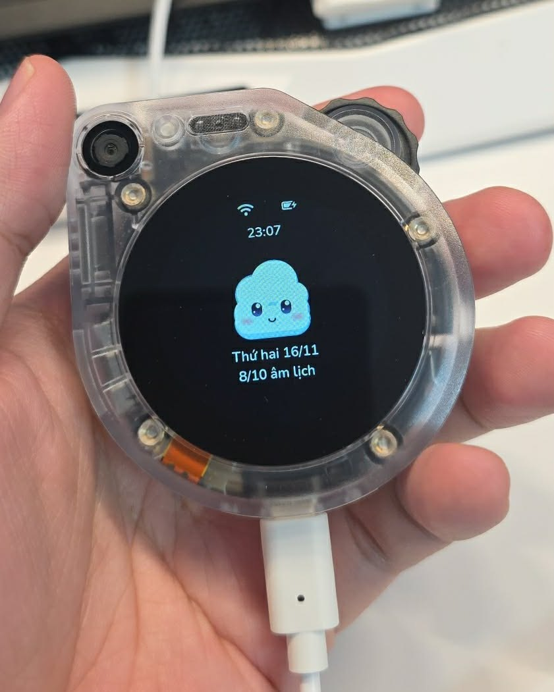
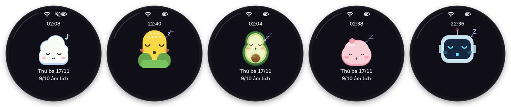
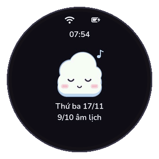
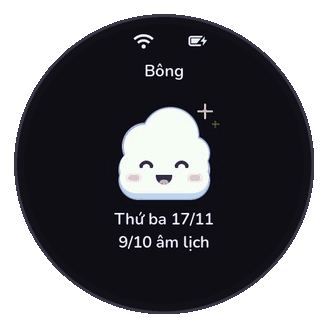
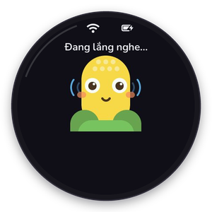
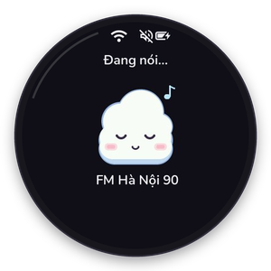
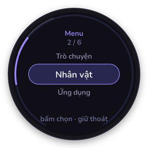
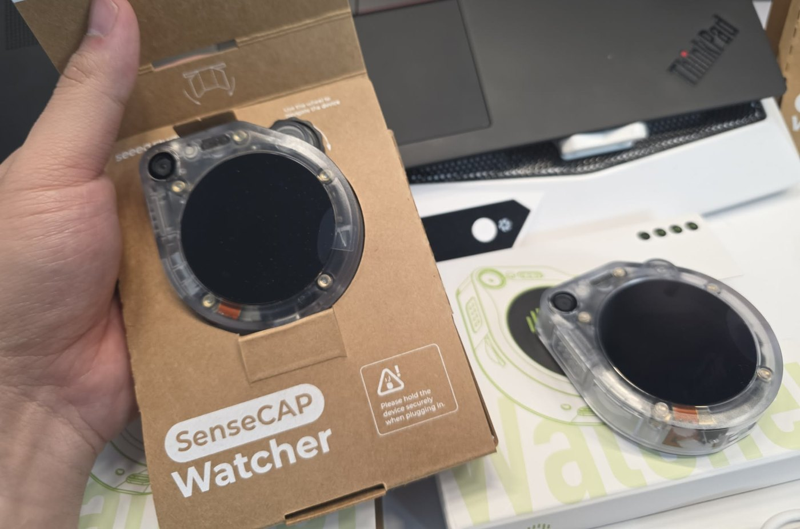

<div align="center">




# Bắp

**Trợ lý giọng nói dễ thương, nhanh nhạy cho Seeed SenseCAP Watcher, nói chuyện thẳng với Google Gemini Live.**

Không máy chủ trung gian, không đám mây riêng. Năm nhân vật, ứng dụng bằng giọng nói, nhạc, radio và
các tiện ích đời sống Việt Nam, tất cả chạy trên một con ESP32-S3.

[](https://github.com/vietanhdev/bap/actions/workflows/ci.yml)


[](LICENSE)

[English](README.md) · **Tiếng Việt** · [Tài liệu](https://bap.nrl.ai/vi)

</div>

---

## Mục lục

- [Hình ảnh](#hình-ảnh)
- [So với firmware gốc](#so-với-firmware-gốc)
- [Tính năng](#tính-năng)
- [Nhân vật](#nhân-vật)
- [Cách hoạt động](#cách-hoạt-động)
- [Hiệu năng](#hiệu-năng)
- [Bắt đầu nhanh](#bắt-đầu-nhanh)
- [Điều khiển](#điều-khiển)
- [Trang cài đặt](#trang-cài-đặt)
- [An toàn và quyền riêng tư](#an-toàn-và-quyền-riêng-tư)
- [Phát triển](#phát-triển)
- [Giấy phép](#giấy-phép)

## Hình ảnh

<p align="center"><br><sub>Năm nhân vật, mỗi nhân vật 23 biểu cảm, vẽ trực tiếp bằng LVGL</sub></p>

<table>
<tr>
<td align="center" width="33%"><br><sub>Hỏi là trả lời, có phụ đề, rồi mở bài hát</sub></td>
<td align="center" width="33%"><br><sub>Vuốt hoặc xoay núm để đổi nhân vật</sub></td>
<td align="center" width="33%"><br><sub>Giữ núm xoay để mở menu tròn</sub></td>
</tr>
</table>

Mọi ảnh màn hình đều chụp trực tiếp từ thiết bị (`GET /screen.jpg`).

<table>
<tr>
<td align="center"><br><sub>Đang lắng nghe</sub></td>
<td align="center"><br><sub>Đang nói, có phụ đề</sub></td>
<td align="center"><br><sub>Zing MP3 kèm lời chạy theo nhạc</sub></td>
<td align="center"><br><sub>Radio (VOV, FM Hà Nội)</sub></td>
</tr>
<tr>
<td align="center"><br><sub>Menu tròn (giữ núm xoay)</sub></td>
<td align="center"><br><sub>Thiết lập bằng núm xoay</sub></td>
<td align="center"><br><sub>Tiếng Hàn</sub></td>
<td align="center"><br><sub>Tiếng Trung</sub></td>
</tr>
</table>

## So với firmware gốc

|  | SenseCraft gốc / xiaozhi upstream | **Bắp** |
| --- | --- | --- |
| Xử lý giọng nói | Âm thanh đi qua máy chủ của hãng hoặc máy chủ tự dựng | **Thiết bị ↔ Gemini Live trực tiếp** (WebSocket + TLS) |
| Từ lúc gọi đến lúc nghe | tùy máy chủ trung gian | **1,4–2,3 giây** (trước khi tối ưu là 2,9 giây), TLS nối lại trong 0,1 giây |
| Gương mặt | Emoji GIF | **5 nhân vật vẽ bằng LVGL**, 23 biểu cảm, nhép miệng theo lời |
| Ngôn ngữ | do máy chủ quyết định | **Việt, Anh, Hàn, Trung** (giao diện, lời nhắc, phụ đề, ngày tháng) |
| Công cụ | Chung chung | **29 công cụ**: lịch âm, thời tiết, tin tức, vàng, tỷ giá, chứng khoán, bóng đá, xổ số, hẹn giờ, ghi chú, ghi nhớ, nhạc, radio |
| Màn hình cảm ứng | Chưa dùng | **Chạm, chạm đúp, vuốt, giữ** (driver SPD2010) |
| AI camera | Luồng tác vụ SenseCraft | **Nhận biết người ngay trên chip**: chào khi thấy người, bản tin sáng |
| Cài đặt | Ứng dụng hoặc trang quản trị của hãng | **Trang web trong mạng nhà**, có mật khẩu, tình trạng máy, OTA 30 giây |
| Ban đêm | Như ban ngày | **Chế độ đêm**: màn hình dịu, loa tối đa 35%, tùy chọn không làm phiền |

Phân vùng `nvsfactory` (khóa thiết bị) không bao giờ bị ghi, và có thể khôi phục firmware gốc bất
cứ lúc nào.

## Tính năng

- **Trò chuyện tự nhiên** qua Gemini Live: âm thanh hai chiều theo thời gian thực, ngắt lời được,
  phụ đề trên màn hình.
- **Năm nhân vật**, mỗi nhân vật có giọng, tính cách và gương mặt riêng. Đổi bằng núm xoay, vuốt màn
  hình hoặc bằng lời ("gọi Bắp ra đây").
- **Ứng dụng bằng giọng nói**: bản tin sáng, kể chuyện cho bé, luyện nói tiếng Anh, học tiếng Hàn,
  nhật ký cuối ngày, tử vi vui, đố vui, hít thở thư giãn, hôm nay ăn gì, tập trung 25 phút, nhìn và
  kể (camera).
- **Công cụ chạy trên thiết bị** (không cần thêm API key): lịch âm, thời tiết và chất lượng không
  khí (Open-Meteo), tin tức (VnExpress), tỷ giá Vietcombank, giá vàng (PNJ, tiệm vàng Hải Hồng),
  VN-Index / VN30 / HNX / UPCoM, lịch và tỷ số bóng đá (Ngoại hạng Anh, C1, La Liga, Serie A,
  Bundesliga, Ligue 1), xổ số, hẹn giờ, báo thức, ghi chú, ghi nhớ lâu dài, chụp ảnh, âm lượng và độ
  sáng.
- **Nhạc và radio**: tìm bài trên Zing MP3 kèm lời chạy theo nhạc, VOV và FM Hà Nội (HLS và MP3),
  nhạc trong thẻ SD (không cần mạng, tìm theo tên không dấu).
- **Bốn ngôn ngữ**: đổi trong trang cài đặt hoặc menu trên máy. Phụ đề Hàn/Trung dùng phông Noto
  Sans KR/SC trong phân vùng assets. Thêm ngôn ngữ chỉ là thêm dữ liệu.
- **Nhận biết có người**: chip AI Himax trong camera nhận ra người ngay trên chip, màn hình sáng lên
  và nhân vật chào bạn. Không gửi ảnh đi đâu, không tốn lượt Gemini.
- **Tiện ích mở rộng**: khai báo webhook (Home Assistant, n8n, máy chủ riêng) trong trang cài đặt, trợ
  lý sẽ gọi qua công cụ `extension.call`.
- **Trang cài đặt** tại `http://bap-xxxx.local` (mỗi máy một tên): API key, model, ngôn ngữ, thành
  phố, nhân vật, sửa tính cách, nhật ký hội thoại, Wi-Fi, mật khẩu, tình trạng máy và OTA.

## Nhân vật

| | Mã | Tên | Là gì | Giọng Gemini | Tính cách |
| :-: | --- | --- | --- | --- | --- |
|  | `bong` | Bông | bé mây bông | Leda | Dịu dàng, ấm áp, hay động viên (mặc định) |
|  | `bap` | Bắp | trái bắp vàng | Puck | Vui nhộn, năng lượng, nói chuyện giòn tan |
|  | `bo` | Bơ | quả bơ sáp | Achird | Điềm đạm, thư thái, quan tâm sức khỏe |
|  | `mochi` | Mochi | viên bánh mochi hồng | Aoede | Ngọt ngào, kể chuyện hay, hợp với trẻ nhỏ |
|  | `ti` | Tí | chú robot tí hon | Kore | Gọn gàng, rành công nghệ |

Nhân vật, ứng dụng, đài radio và ngôn ngữ đều là **dữ liệu** trong
[`firmware/data/assistant.json`](firmware/data/assistant.json). Xem
[docs/adding-a-character.md](docs/adding-a-character.md).

<p align="center"></p>

## Cách hoạt động

<p align="center"></p>

Bắp là một lớp mỏng trên [xiaozhi-esp32](https://github.com/78/xiaozhi-esp32): một `Protocol` mới
nói chuyện với Gemini Live API, cùng các module `assistant::` cho cấu hình, công cụ, trang web, gương
mặt, menu và điều khiển. Thay đổi với upstream gói gọn trong một bản vá nhỏ,
[`firmware/patches/xiaozhi-esp32.patch`](firmware/patches/xiaozhi-esp32.patch).

<p align="center"></p>

Chi tiết: [docs/architecture.md](docs/architecture.md) ·
[thêm công cụ](docs/adding-a-tool.md) · [thêm nhân vật](docs/adding-a-character.md).

## Hiệu năng

<p align="center"></p>

Các thay đổi chính: dùng lại phiên TLS (session ticket) cho mọi kết nối, tối ưu ECP fixed-point,
chuyển stack của tác vụ sang PSRAM, giảm số khung hình hoạt ảnh, bỏ bớt codec, xóa flash trước khi
ghi khi OTA, tạm dừng từ đánh thức và AI camera trong lúc cập nhật. `GET /api/perf` cho biết CPU từng
tác vụ, stack còn trống, heap, thời gian chạy và sóng Wi-Fi.

<p align="center"></p>

## Bắt đầu nhanh

<p align="center"> <br><sub>Watcher: màn hình tròn cảm ứng 412×412, núm xoay, camera có chip AI, micro và loa</sub></p>

**Cần có:** SenseCAP Watcher (W1-A/W1-B hoặc bản "for XiaoZhi"), cáp USB-C dữ liệu, máy Linux có
Docker và [uv](https://docs.astral.sh/uv/), một Gemini API key từ
[Google AI Studio](https://aistudio.google.com/apikey).

### 0. Sao lưu firmware gốc (làm một lần)

```bash
mkdir -p backup
uv run --with esptool esptool --chip esp32s3 --port /dev/serial/by-id/usb-1a86_USB_Dual_Serial_*-if02 \
  --baud 921600 read-flash 0x0 0x2000000 backup/watcher-w1a-esp32s3-full-32MB.bin
( cd backup && sha256sum watcher-w1a-esp32s3-full-32MB.bin > watcher-w1a-esp32s3-full-32MB.bin.sha256 )
```

Bản sao lưu chứa khóa riêng của thiết bị. **Không bao giờ commit hay chia sẻ thư mục `backup/`.**

### 1. Lấy mã upstream và áp bản vá

```bash
firmware/scripts/apply_patch.sh   # clone xiaozhi-esp32 @ aaf1eb7 vào vendor/ rồi áp bản vá
```

### 2. Build

```bash
mkdir -p secrets && chmod 700 secrets
printf '%s' 'YOUR_GEMINI_API_KEY' > secrets/GEMINI_API_KEY && chmod 600 secrets/GEMINI_API_KEY

firmware/build.sh          # firmware (Docker espressif/idf:release-v6.1) → vendor/xiaozhi-esp32/build/xiaozhi.bin
firmware/build_assets.sh   # phông chữ, gương mặt, từ đánh thức → firmware/build/assets.bin
```

Để trống `secrets/GEMINI_API_KEY` nếu muốn nhập key sau trong trang cài đặt (firmware do CI build
không bao giờ có key). Tùy chọn: `secrets/GEMINI_API_KEY_PAID` là key của một project đã bật thanh
toán, chỉ dùng khi key miễn phí bị từ chối; key miễn phí được thử lại sau 1, 2, 4… tối đa 15 phút.

Biến khi build: `GEMINI_MODEL`, `GEMINI_VOICE`, `WAKE_WORD` (mặc định `wn9_hilili_tts`, tức "Hi
Lili"), `LANG_CODE`.

### 3. Nạp firmware

```bash
firmware/flash.sh               # lần đầu: bootloader, bảng phân vùng, otadata, ứng dụng, assets
firmware/flash_app.sh           # những lần sau: chỉ ứng dụng
firmware/ota.sh bap-xxxx.local  # qua Wi-Fi, không cần cáp (khoảng 30 giây)
```

Các script tự tìm Watcher trên cổng USB; nếu cắm nhiều máy, chọn một máy bằng
`PORT=/dev/serial/by-id/...`.

### 4. Wi-Fi và lần trò chuyện đầu tiên

1. Lần đầu khởi động, Watcher phát Wi-Fi tên **`Bap-XXXX`**. Kết nối điện thoại vào mạng đó, chọn
   Wi-Fi nhà bạn và nhập mật khẩu (hoặc mở `http://192.168.4.1`).
2. Mở **`http://bap-xxxx.local`** (địa chỉ cũng hiện trên màn hình).
3. Nhập Gemini API key nếu chưa build kèm, chọn thành phố, ngôn ngữ và nhân vật.
4. Nói **"Hi Lili"**, chạm đúp màn hình hoặc nhấn núm xoay rồi bắt đầu nói chuyện.

Đổi Wi-Fi sau này: giữ núm xoay → **Thiết lập → Cài Wi-Fi**, hoặc bấm nút trong trang cài đặt.

## Điều khiển

<p align="center"></p>

| Trạng thái | Núm xoay | Cảm ứng |
| --- | --- | --- |
| Đang nghỉ | xoay: đổi nhân vật · nhấn đúp: ứng dụng | chạm: cười khúc khích · chạm đúp: trò chuyện · vuốt: đổi nhân vật |
| Đang trò chuyện | xoay: âm lượng · nhấn: dừng / tiếp tục | chạm: ngắt lời |
| Đang phát nhạc | — | chạm đúp: dừng nhạc |
| Bất kỳ | giữ 1 giây: menu · giữ 20 giây: xóa cài đặt | giữ: menu |
| Trong menu | xoay / nhấn: di chuyển / mở | vuốt hoặc chạm trên/dưới: di chuyển · chạm giữa: mở |

## Trang cài đặt

<table>
<tr>
<td align="center"><br><sub>Trò chuyện, đang phát, hỏi nhanh</sub></td>
<td align="center"><br><sub>Nhân vật và tính cách</sub></td>
<td align="center"><br><sub>Tình trạng máy</sub></td>
<td align="center"><br><sub>Giao diện tối</sub></td>
</tr>
</table>

Ảnh chụp dùng dữ liệu mẫu.

## An toàn và quyền riêng tư

- **API key nằm trên thiết bị** (NVS, hoặc nhúng lúc build từ `secrets/`). Trình duyệt chỉ thấy key
  đã che, và thiết bị chỉ gửi key tới Google qua TLS. Ai có quyền truy cập vật lý vào máy hoặc file
  `xiaozhi.bin` bạn tự build đều đọc được key, vì vậy hãy dùng key riêng có giới hạn quota và không
  chia sẻ file đã build.
- **Trang cài đặt chỉ dùng trong mạng LAN**, có thể đặt mật khẩu (HTTP Basic, lưu dạng băm SHA-256 có
  salt và lặp nhiều vòng). Mọi thay đổi (POST) phải có header `X-Bap`, chặn được việc trang web lạ
  gửi form sang thiết bị. Đừng mở cổng 80 của máy ra Internet.
- **`nvsfactory` ở `0x9000`** (khóa thiết bị của Seeed) không bao giờ bị ghi: các script chỉ ghi
  `0x0`, `0x8000`, `0x10d000`, `0x200000` và `0xa00000`.
- Âm thanh chỉ gửi lên Gemini khi đang trò chuyện (sau từ đánh thức, chạm hoặc nhấn núm); phiên tự
  đóng sau 30 giây im lặng. Ảnh camera chỉ gửi đi khi trợ lý gọi công cụ chụp ảnh. Nhận biết người
  chạy ngay trên chip AI của camera.
- Không bao giờ commit `secrets/`, `backup/`, `server/.env`, `vendor/`, `firmware/build/` hay file
  log build. Xem [CONTRIBUTING.md](CONTRIBUTING.md).

### Khôi phục firmware gốc

```bash
firmware/restore_stock.sh   # kiểm tra SHA-256 của bản sao lưu rồi ghi lại toàn bộ 32 MB từ 0x0
```

Nếu không có bản sao lưu riêng, cài lại firmware SenseCraft chính thức bằng công cụ của Seeed; khóa
thiết bị trong `nvsfactory` vẫn còn nguyên.

## Phát triển

```bash
python3 firmware/scripts/validate_data.py      # kiểm tra assistant.json và mọi công cụ được nhắc tới
for t in firmware/tests/test_*.cc; do g++ -std=c++17 -I firmware/src/assistant -o /tmp/t "$t" && /tmp/t; done
firmware/scripts/export_patch.sh               # sau khi sửa vendor/, cập nhật bản vá
```

CI (`.github/workflows/ci.yml`) chạy kiểm thử, kiểm tra dữ liệu, clang-format, build firmware với
API key rỗng và quét bí mật bằng gitleaks.

## Giấy phép

- Mã nguồn Bắp: [MIT](LICENSE).
- [xiaozhi-esp32](https://github.com/78/xiaozhi-esp32): MIT, bản quyền các tác giả upstream.
- `TicketSsl` dựa trên [esp-ml307](https://github.com/78/esp-ml307) (Apache-2.0).
- Phông chữ [Nunito](https://github.com/googlefonts/nunito) và
  [Noto Sans KR/SC](https://github.com/notofonts/noto-cjk): SIL Open Font License 1.1
  (`firmware/assets/fonts/`).
- Thuật toán lịch âm theo công bố của Hồ Ngọc Đức.
- Bắp không liên kết với Seeed Studio hay Google. "SenseCAP" và "Gemini" là nhãn hiệu của chủ sở hữu
  tương ứng.
