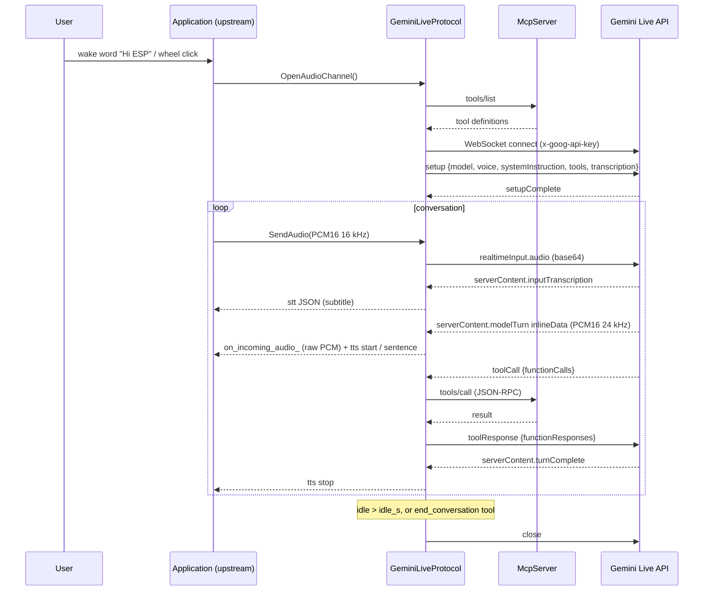

# Architecture

Bắp is a thin layer on top of upstream [xiaozhi-esp32](https://github.com/78/xiaozhi-esp32).
Upstream provides the board support, audio pipeline (AFE, wake word, playback), LVGL display,
Wi-Fi provisioning and an on-device MCP server. Bắp adds:

1. a new `Protocol` implementation that talks to the Gemini Live API directly, and
2. a set of `assistant::` modules (config, tools, web UI, faces, wheel input, lunar calendar).

Everything specific to a character or an app is **data** in `firmware/data/assistant.json`; the C++
code is generic.

## Source layout and build

| Path | Role |
| --- | --- |
| `firmware/src/protocols/gemini_live_protocol.{h,cc}` | `GeminiLiveProtocol : Protocol`. WebSocket session with Gemini Live, audio up/down, transcripts, tool-call bridge |
| `firmware/src/assistant/assistant_config.{h,cc}` | `Config`, `Character`, `Look`, `App`. Built-in data from `assistant.json` layered with NVS overrides. `SystemPrompt()` |
| `firmware/src/assistant/assistant_tools.cc` | `RegisterTools()`: Vietnamese tools on the MCP server. Scheduler (timers, alarms), clock sync, conversation log, `Say()` |
| `firmware/src/assistant/assistant_web.cc` | `StartWebServer()`: settings UI and JSON API on port 80, mDNS `bap-xxxx.local` (last 4 hex digits of the MAC) |
| `firmware/src/assistant/assistant_face.{h,cc}` | `FaceShow()`, `FaceSetTalking()`: characters drawn natively with LVGL |
| `firmware/src/protocols/ticket_ssl.{h,cc}` | `TicketSsl`/`TicketNetwork`/`FastNetwork()`: TLS with session-ticket resumption for every outgoing connection (derived from esp-ml307's `EspSsl`, Apache-2.0) |
| `firmware/src/assistant/assistant_input.cc` | Wheel and touch gestures (`OnWheel*`, `OnTouch`), presence reactions (`OnPersonPresent/Arrived`), morning briefing, do-not-disturb (`QuietHours`) |
| `firmware/src/assistant/assistant_menu.{h,cc}` | Round-screen menu (hold the wheel or the screen): characters, apps, radio, settings, power |
| `firmware/src/assistant/assistant_auth.{h,cc}` | Optional settings password (HTTP Basic, salted SHA-256 in NVS), `RegisterGuarded()` for every route |
| `firmware/src/assistant/assistant_radio.{h,cc}` | `PlayRadio()`: MP3/AAC streams, HLS playlists, SD-card files, through the notification player |
| `firmware/src/assistant/assistant_zing.{h,cc}` | Zing MP3 search, stream URL and synced lyrics (signed web API) |
| `firmware/src/assistant/assistant_sd.{h,cc}` | SD-card song index and matching (`SdSongs()`) |
| `firmware/src/assistant/assistant_fonts.cc` | Korean/Chinese fallback font from the assets partition |
| `firmware/src/assistant/assistant_notify.cc` | `POST /api/notify` status cards (desktop companion) |
| `firmware/src/assistant/assistant_perf.cc` | `GET /api/perf`: per-task CPU, stack headroom, heap, uptime, RSSI |
| `firmware/src/assistant/assistant_memory.cc` | cJSON allocations in PSRAM (internal RAM is the scarce resource) |
| `firmware/src/assistant/text_fold.h`, `lrc.h` | Header-only helpers with host tests: accent folding, LRC lyrics parser |
| `firmware/src/assistant/vn_lunar.h` | Header-only Vietnamese lunar calendar (`FromSolar`, `ToSolar`, `YearName`, `DayName`, `Festival`) |
| `firmware/src/assistant/assistant.h` | Public `assistant::` entry points used by the upstream code |
| `firmware/data/assistant.json` | Characters, shared rules, apps, radio stations, languages (prompt + UI strings) |
| `firmware/sdkconfig.gemini` | Extra sdkconfig for the Gemini build (memory, TLS, codecs), shared by `build.sh` and CI |
| `firmware/web/index.html` | Single-page settings UI served by the device |
| `firmware/patches/xiaozhi-esp32.patch` | Small hooks into upstream (see below) |

`firmware/build.sh` copies `src/assistant/*` into `vendor/xiaozhi-esp32/main/assistant/` and
`src/protocols/*` into `main/protocols/`, then embeds two files as C++ raw strings:

- `web/index.html` as `kWebPage` in `main/assistant/web_page.h`
- `data/assistant.json` as `kAssistantJson` in `main/assistant/builtin_data.h`

It writes `main/boards/sensecap-watcher/config.home.json` with `CONFIG_USE_GEMINI_LIVE=y`, the API
key, model and voice plus every line of `firmware/sdkconfig.gemini`, and runs upstream `scripts/build.py` in the `espressif/idf:release-v6.1`
container.

### What the upstream patch changes

`firmware/patches/xiaozhi-esp32.patch` is produced by `firmware/scripts/export_patch.sh` and applied
by `firmware/scripts/apply_patch.sh` on top of commit `aaf1eb7798cabee87a0c6a0649aabf4d17e9e383`.
All changes are guarded by `CONFIG_USE_GEMINI_LIVE`:

| File | Change |
| --- | --- |
| `main/Kconfig.projbuild` | `USE_GEMINI_LIVE`, `GEMINI_API_KEY`, `GEMINI_MODEL`, `GEMINI_VOICE`, `GEMINI_IDLE_TIMEOUT_S`, `GEMINI_GOOGLE_SEARCH` |
| `main/CMakeLists.txt` | Compile `protocols/gemini_live_protocol.cc` and `assistant/*.cc`; link `esp_http_server` |
| `main/idf_component.yml` | Add `espressif/mdns` |
| `main/application.cc` | Create `GeminiLiveProtocol`; forward synthetic wake words (`<say>`, `<detect>`); backpressure on the decode queue; resting face and `IdleLine()` |
| `main/audio/audio_service.cc` | Raw PCM16 in both directions instead of Opus (`frame_duration == 0` downlink, resampled 24 kHz to codec rate) |
| `main/boards/common/wifi_board.cc` | Hotspot prefix `Bap`, hide the OTA URL field |
| `main/boards/sensecap-watcher/sensecap_watcher.cc` | Route wheel events to `assistant::OnWheel*()` |
| `main/boards/sensecap-watcher/sscma_camera.cc` | `Explain()` sends the JPEG into the Gemini session |
| `main/display/lcd_display.cc` | Dark theme, `SetEmotion()` calls `assistant::FaceShow()` instead of GIF emoji |
| `main/display/lvgl_display/lvgl_display.cc` | Snapshot byte order fix for `/screen.jpg` |

## Runtime

### Startup

`Application` creates `GeminiLiveProtocol`. `GeminiLiveProtocol::Start()` sets the time zone
(`ICT-7`), starts SNTP and also `assistant::SyncClock()` (HTTP `Date` header, for networks that
block NTP), then calls `assistant::RegisterTools()`, `StartScheduler()` and `StartWebServer()`.
If no API key is configured it shows an error pointing to `http://bap-xxxx.local`.

### Session (device <-> Gemini Live)



Details, all in `gemini_live_protocol.cc`:

- **Endpoint**: `wss://generativelanguage.googleapis.com/ws/google.ai.generativelanguage.v1beta.GenerativeService.BidiGenerateContent`,
  key sent in the `x-goog-api-key` header.
- **Setup** (`BuildSetupMessage()`): `models/<cfg.model>`, `responseModalities: ["AUDIO"]`,
  `prebuiltVoiceConfig.voiceName` = the active character's voice, input and output transcription
  on, `systemInstruction` = `assistant::SystemPrompt()` plus the user's city, saved memories
  (`LoadList("memory")`) and the current date and time. Optional `googleSearch` tool when
  `Config::search` is on; if the session is rejected with search on, search is turned off and the
  session retried once.
- **Uplink**: `SendAudio()` base64-encodes raw PCM16 16 kHz mono into
  `realtimeInput.audio`. `SendUserText()` sends `realtimeInput.text` (used for system events,
  app prompts and web UI text). `SendImage()` sends a JPEG as `realtimeInput.video`.
  `SendStopListening()` sends `audioStreamEnd`.
- **Downlink**: `HandleServerContent()` handles `inputTranscription` (shown as the user subtitle),
  `modelTurn.parts[].inlineData` (PCM16 24 kHz, passed to the audio service in raw mode by
  `DeliverAudio()`), `outputTranscription` (split into screen-sized subtitles by
  `FlushAssistantText()`, with an emotion guessed by `GuessEmotion()`), `interrupted` and
  `turnComplete` (`FinishTurn()`).
- **Translation to upstream**: the protocol emits the same `tts`, `stt` and `llm` (emotion) JSON
  messages that upstream servers send (`EmitTts()`, `EmitStt()`, `EmitEmotion()`), so the
  upstream `Application` state machine and display work unchanged.
- **Session end**: after `idle_s` seconds without activity (default `CONFIG_GEMINI_IDLE_TIMEOUT_S`
  = 30), or when the model calls the built-in `end_conversation` function (closes after the
  current turn).

### MCP tools bridged to Gemini function calls

The device already runs an MCP server (`McpServer`, upstream). Tools are registered there with
`McpServer::AddTool(name, description, PropertyList, callback)`. Bắp does not duplicate them for
Gemini; the protocol bridges the two at runtime:

1. **Declarations.** `GeminiLiveProtocol::BuildToolDeclarations()` sends
   `{"method":"tools/list"}` to `McpServer::ParseMessage()` and converts every tool into a Gemini
   `functionDeclarations` entry:
   - `name`: MCP names contain dots (`vn.lunar_date`, `self.camera.take_photo`); Gemini names allow
     only letters, digits, `_` and `-`, so `ToFunctionName()` replaces `.` with `_` and truncates
     to 64 characters. The mapping is kept in `fn_to_tool_`.
   - `description`: copied as is.
   - `parametersJsonSchema`: the MCP `inputSchema` copied as is.
   - An extra local function `end_conversation` is appended.
   - Tools registered with `AddUserOnlyTool()` are not listed (upstream hides them from
     `tools/list` unless `withUserTools` is set), so the model cannot call them.
2. **Calls.** `HandleToolCall()` receives `toolCall.functionCalls[]`. For each call it looks up the
   MCP name in `fn_to_tool_`, allocates a JSON-RPC id (`next_mcp_id_`), remembers
   `(call id, function name)` in `pending_calls_`, and sends `tools/call` with the call's `args`
   as `arguments` to `McpServer::ParseMessage()`.
3. **Results.** The MCP server replies through `SendMcpMessage()` (the protocol's MCP transport).
   The reply is matched by JSON-RPC id, and `SendToolResponse()` sends
   `toolResponse.functionResponses[] = {id, name, response: {result | error}}` back to Gemini.

Note: upstream `McpServer::GetToolsList()` paginates replies larger than 8000 bytes and returns a
`nextCursor`. `BuildToolDeclarations()` currently reads only the first page, so keep tool
descriptions concise, and check the `Exposed N device tools to Gemini` log line after adding tools.

The same MCP server is also reachable from the web UI (`POST /api/tool`), which is handy for
testing a tool without talking to the device.

### Characters and apps are data

`firmware/data/assistant.json`:

```jsonc
{
  "default_character": "bong",
  "common_rules": "...rules appended to every persona...",
  "characters": [
    { "id": "bap", "name": "Bắp", "kind": "trái bắp vàng", "voice": "Puck",
      "tagline": "...", "persona": "...",
      "look": { "shape": "corn", "body": "#FFD84D", "accent": "#7EC460", "ink": "#4A3420", "cheek": "#FF8F6B" } }
  ],
  "apps": [ { "id": "do_vui", "title": "Đố vui", "desc": "...", "prompt": "...script for the model..." } ]
}
```

How each field is used (`assistant_config.cc` unless noted):

| Field | Used by |
| --- | --- |
| `id` | NVS key for overrides (`"c_" + id`), active character in `Config::character`, face asset names `<id>_<emotion>.gif` |
| `name`, `kind` | `SystemPrompt()` (list of other characters), `character.switch` tool (`SetActiveCharacter()` matches id or name), wheel preview |
| `voice` | `prebuiltVoiceConfig.voiceName` in the session setup |
| `persona` | First part of `SystemPrompt()` |
| `tagline` | Shown when choosing the character with the wheel (`OnWheelRotate()`) and in the web UI |
| `look.shape` | `BuildBody()` in `assistant_face.cc`: `cloud` (default), `corn`, `avocado`, `mochi`, `robot` |
| `look.body/accent/ink/cheek` | Colors for the body, details, eyes and mouth, cheeks |
| `apps[]` | `Apps()`: wheel app launcher (`OnWheelClick()` sends the prompt via `Say()`), `app.open` tool, list in `SystemPrompt()` |

Overrides: the web UI can change a character's `name`, `voice` and `persona`. They are saved by
`SaveCharacterOverride()` as one small JSON string per character in NVS namespace `assistant`;
empty values restore the built-in data. `Characters()` merges built-in values and overrides.

Faces: on the device, `assistant_face.cc` draws the character natively from `look` (23 expressions
in `kExpressions`, mouth animation while talking via `FaceSetTalking()`). The GIFs generated by
`firmware/assets/make_faces.py` into `firmware/assets/faces/` are packed into the assets partition
by `build_assets.sh` and served by the web UI at `/face?c=<id>&e=<emotion>` for previews.

### Persistent state (NVS namespace `assistant`)

`api_key`, `model`, `character`, `city`, `lat`, `lon`, `idle_s`, `search`, `greet`, `night_dim`
(`LoadConfig()` / `SaveConfig()`); `c_<id>` character overrides; JSON lists `notes`, `memory`,
`alarms`, `hooks` (`LoadList()` / `SaveList()`). `greet` also sets the camera person detector in
namespace `model`.

### Web UI and API (`assistant_web.cc`)

| Route | Purpose |
| --- | --- |
| `GET /` | `kWebPage` (firmware/web/index.html) |
| `GET /api/config`, `POST /api/config` | Read (API key masked) and save settings, characters, hooks |
| `GET /api/status` | Device state, active character, log, alarms |
| `POST /api/say` | Send text to the assistant as if spoken |
| `POST /api/action` | Device actions (talk, reboot) |
| `POST /api/tool` | Call an MCP tool directly |
| `POST /api/app` | Start an app |
| `POST /api/ota` | Upload a new `xiaozhi.bin` (used by `firmware/ota.sh`) |
| `GET /face`, `GET /screen.jpg` | Face GIF preview, screenshot |

Every `POST` requires an `X-Bap` header (`SameOrigin()`); browsers cannot add custom headers to a
cross-site form post, so another website cannot drive the device from a visitor's browser. There
is no authentication: the UI is meant for a trusted LAN only.

## Flash layout

| Offset | Content | Written by |
| --- | --- | --- |
| `0x0` | bootloader | `flash.sh` |
| `0x8000` | partition table (`partitions/v2/32m.csv`) | `flash.sh` |
| `0x9000` | `nvsfactory` (Seeed device EUI and keys) | **never** |
| `0x10d000` | otadata | `flash.sh` |
| `0x200000` | application `xiaozhi.bin` | `flash.sh`, `flash_app.sh`, `ota.sh` (OTA slot) |
| `0xa00000` | assets (font, faces, wake word model) | `flash.sh`, `flash_assets.sh` |
